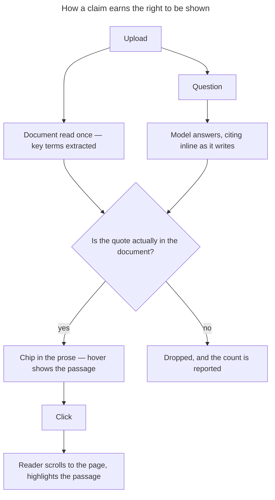

# Verified answers for commercial real estate due diligence

A document Q&A tool for commercial real estate lawyers, extended so that **every claim
it makes can be checked in one click — whether the lawyer asked the question or not.**

**Loom walkthrough — Part 1:** <https://www.loom.com/share/7b5fe7f22b1142aa8293ba9deea051d5>
**Loom walkthrough — Part 2:** <https://www.loom.com/share/c984e60f754c4ef4aaabdd73623d785c>
**Why this and not something else:** [`DECISIONS.md`](./DECISIONS.md)
**Part 1 — written question:** [`PART-1.md`](./PART-1.md)

---

## What changed

The baseline answered questions well and then undermined itself. It displayed a
**"3 sources cited"** badge produced by counting regex matches of the string
`clause \d+` in its own reply, beside a document pane that could not be navigated to a
clause. A lawyer cannot rely on a claim they have not seen in the document, so that
badge asked for trust it had not earned.

### Citations that point at something

The model now cites inline as it writes. Each citation is **checked against the page it
claims to come from before it is shown**, in three tiers — exact, whitespace- and
punctuation-normalised, then the longest agreeing run — because PDF extraction breaks
lines mid-clause and disagrees with the model about ligatures and curly quotes. Quotes
that cannot be found are dropped, and the count of dropped references is reported under
the answer rather than hidden.

- **Hover a chip** to read the passage in the document's own words.
- **Click it** to jump the reader to that page with the passage highlighted.
- Approximate matches are marked as approximate rather than presented as clean hits.
- If a passage cannot be located in the rendered page, the click still takes you to the
  page. A citation never dead-ends.

### The document is read before you ask it anything

Chat can only answer questions a lawyer already knows to ask, and someone opening an
unfamiliar 200-page lease does not yet know — working that out *is* the due diligence.
So a document is read once on arrival and the terms a reviewer looks for are on screen
before a question is typed, each one carrying the same verified citation.

Fields are not fixed. The sample lease returns rent, term, break rights, permitted use
and indemnities; the title report returns restrictive covenants, the registered charge
and the s106 obligations. Items that would cost the client money — the upward-only
review, the break premium buried in clause 8.3.1 — are flagged for escalation.

### Rough edges made smooth

- **A failed request no longer looks like an answer.** The baseline caught LLM errors,
  replaced them with an apology and **saved that as the assistant's message**. Nothing
  is persisted now; the UI offers *Ask again*.
- **The sidebar is a document list.** Conversations are named after the document they
  hold, not after the first question asked.
- **Upload is the front door** — dropping a PDF creates the conversation around it.
- The upload spinner, already written and never connected, is connected.
- The delete control is no longer a `<button>` nested inside another `<button>`.
- `ruff`, `pyright` and `pytest` all pass. They did not before: `backend/tests` was
  never mounted into the container, and `pyright` could not run at all for want of
  `libatomic1`.

---

## Setup

### Prerequisites

- Docker and Docker Compose
- just — `brew install just` or `cargo install just`

### Getting started

```bash
just setup                       # copies .env.example to .env, builds the images
# add ANTHROPIC_API_KEY to .env
just dev                         # Postgres + backend (:8000) + frontend (:5173)
```

Open <http://localhost:5173>. Migrations run automatically on boot.

`backend/src/` and `frontend/src/` are mounted into the containers, so edits hot-reload.

### Try it

1. Drop `sample-docs/commercial-lease-100-bishopsgate.pdf` onto the empty app.
2. Read **Key terms** — 10 of them, 4 flagged for review.
3. Click `§8.3.1(c) · p7` on the break-rights row. The reader jumps to page 7 and
   highlights the break premium.
4. Ask *"Can we break the lease in 2029?"* and click through the chips in the answer.
5. Ask *"What does Schedule 3 say about the service charge?"* — the lease references
   Schedules 1–4 and contains none of them. It says so and cites the reference.

### Commands

- `just dev` — start the full stack
- `just stop` / `just reset` — stop, or stop and clear the database
- `just check` — ruff, pyright, biome, tsc **and the tests**
- `just test` — pytest only
- `just fmt` — format everything
- `just db-shell` / `just shell-backend` / `just logs-backend`

---

## How it fits together



### Where the work lives

| Path | What it does |
|---|---|
| `backend/src/takehome/services/citations.py` | Three-tier matching. Decides whether a claim gets a source or gets nothing |
| `backend/src/takehome/services/llm.py` | Citation markers, and the streaming parser that keeps half-written ones out of the answer |
| `backend/src/takehome/services/summary.py` | Reads a document on arrival; drops any term it cannot evidence |
| `frontend/src/lib/text-match.ts` | Mirrors `citations.py` — the passage has to be findable in pdf.js's text layer too |
| `frontend/src/components/DocumentViewer.tsx` | Continuous scroll, addressable from outside, highlight measured and merged per line |
| `backend/tests/test_citations.py` | 19 tests over the matching rules |

### Structure

- `frontend/` — React, Vite, Tailwind, Radix
- `backend/` — FastAPI, SQLAlchemy, PydanticAI
- `alembic/` — migrations (`005_summaries` is the most recent)
- `sample-docs/` — the three sample PDFs
